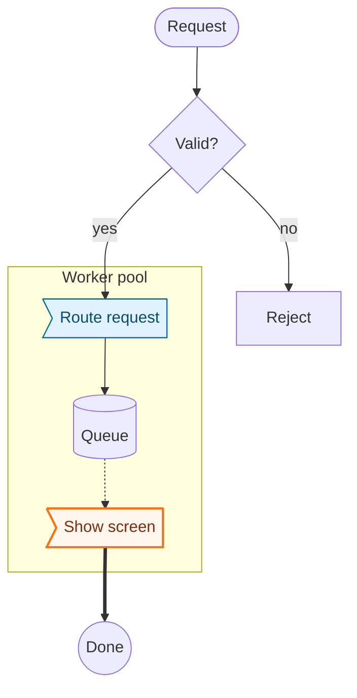
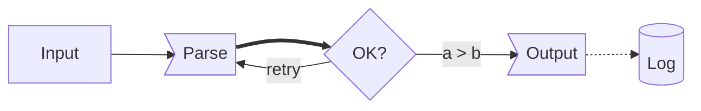
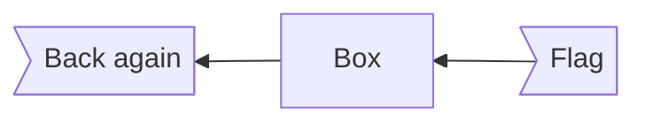
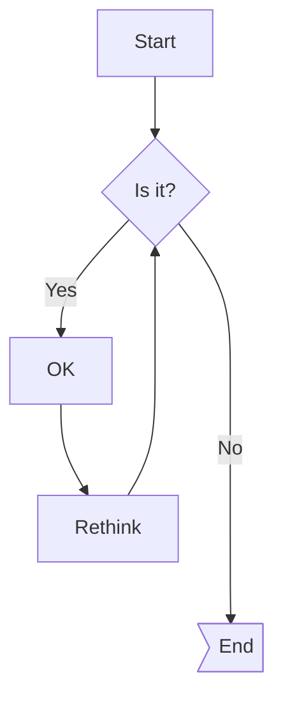
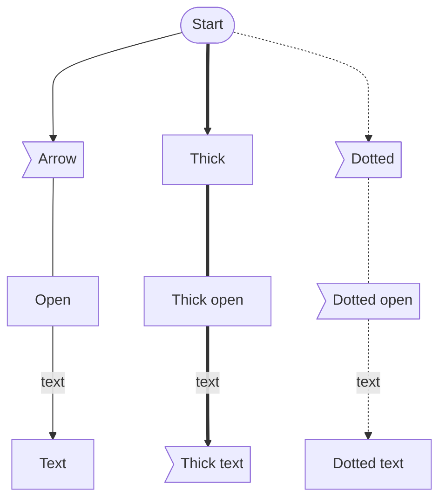

# Mermaid asymmetric shape

Mermaid's **asymmetric** node, `id>text]`, is a rectangle with a notch cut
into its left side, like a flag. Its text sits in the rectangle beside the
notch, and an edge that comes in from the left meets the notch's tip. See
[Mermaid's flowchart syntax](https://mermaid.js.org/syntax/flowchart.html).
*Every* fence below draws as a diagram.

## Top to bottom

A request runs through a worker pool. The screen node is styled with
`classDef`, the route node with `style`, and the screen node sits inside the
subgraph.



## Left to right

| Source | Shape | Text |
| --- | --- | --- |
| `S>Screen]` | asymmetric | Screen |
| `A>"Quoted > label"]` | asymmetric | a `>` inside quotes stays text |
| `C>"Two lines … of label"]` | asymmetric | a quoted label over two lines |
| `D>One; two \| three]` | asymmetric | `;` and `\|` stay in the label |
| `B[Plain]` | rectangle | unchanged |

```mermaid
flowchart LR
    R[Render] -.-> S>Screen]
    A>"Quoted > label"] -->|a > b| B[Plain]
    B -- text --> C>"Two lines
        of label"]
    C ==> D>One; two | three]
```

Every arrow next to the shape, the label's own `>` included:



## Right to left

1. The first node is asymmetric, so its edge leaves through the notch.
2. The last node is asymmetric too; the edge meets its flat right side.



> An arrow's `>` (`-->`, `==>`, `-.->`) is never read as the shape, nor is
> one inside an edge label such as `-->|a > b|`.

- As source, a dotted edge to the shape reads:

  ```text
  R -.-> S>Screen]
  ```

- Tinta used to draw that as one rectangle labelled `S>Screen]`.

## Longer links

Mermaid's own example of a longer link, `---->|No|`, with its end node made
asymmetric:



Each kind of link drawn longer than its shortest form, with and without a
head or text. A longer link is drawn like its short form.



## After the diagrams

Text after the last diagram still lays out, with **bold**, *italic* and
`code`.
