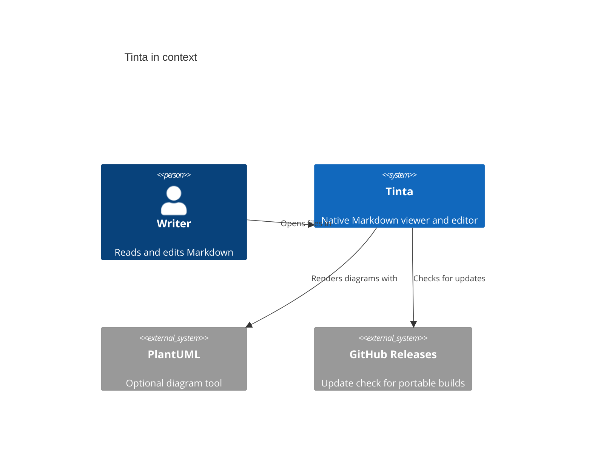
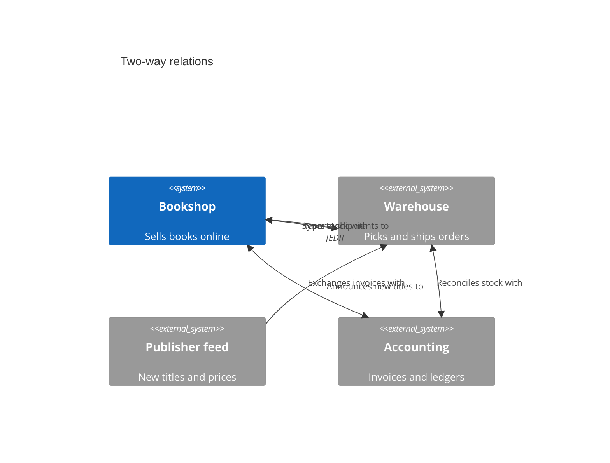
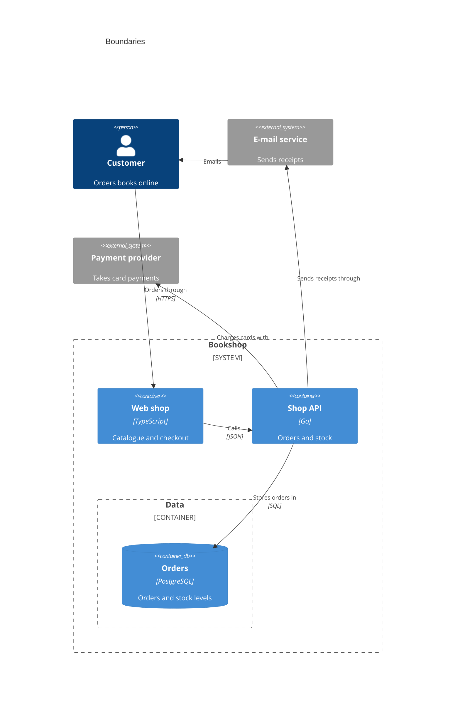
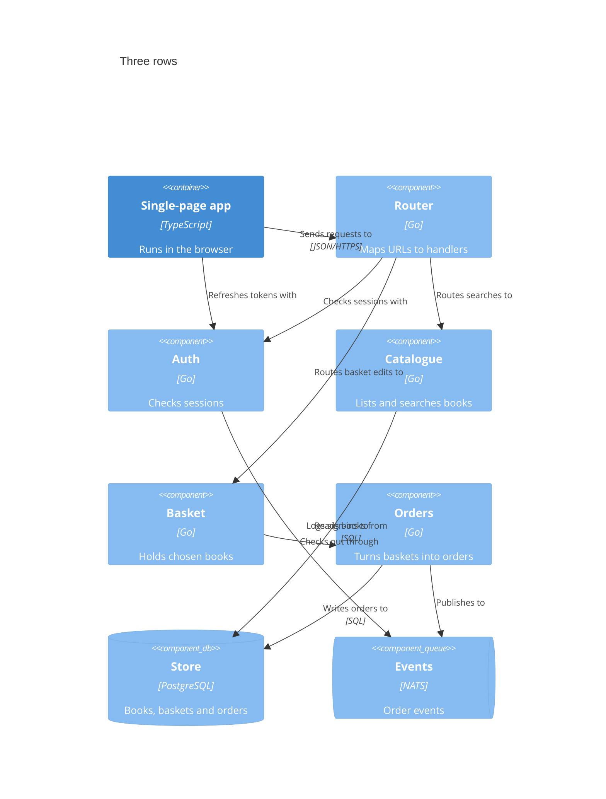
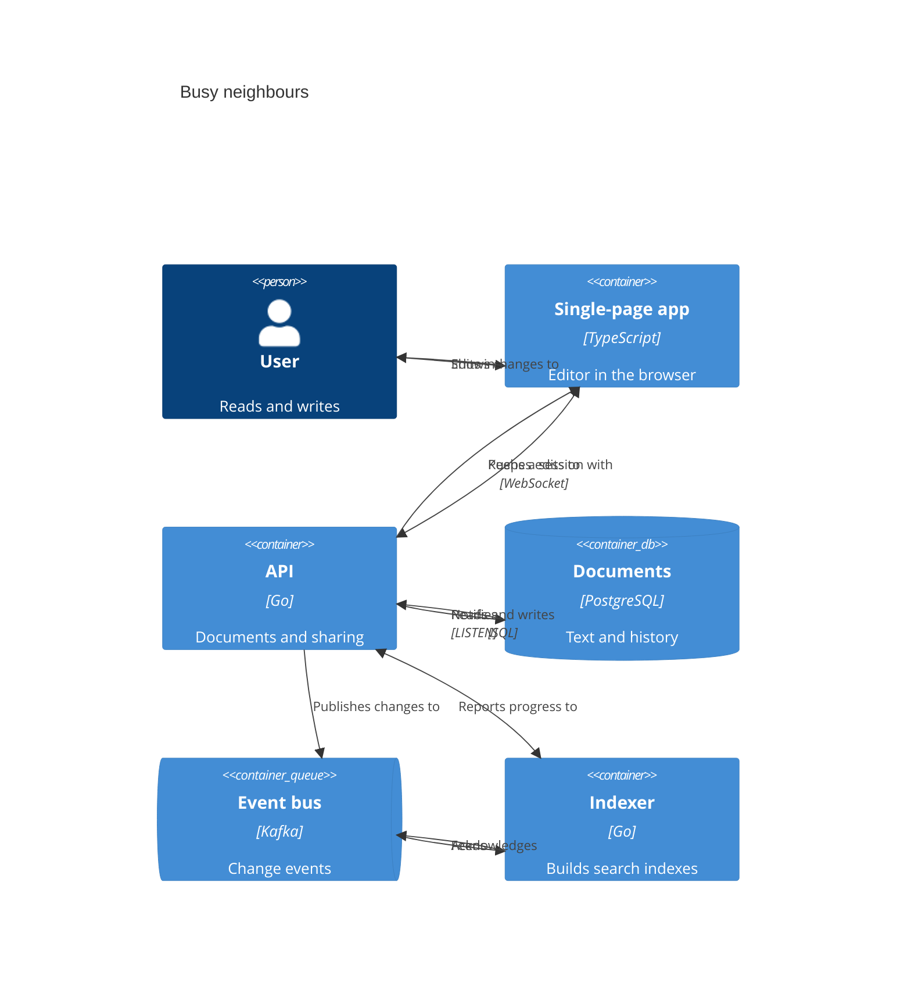
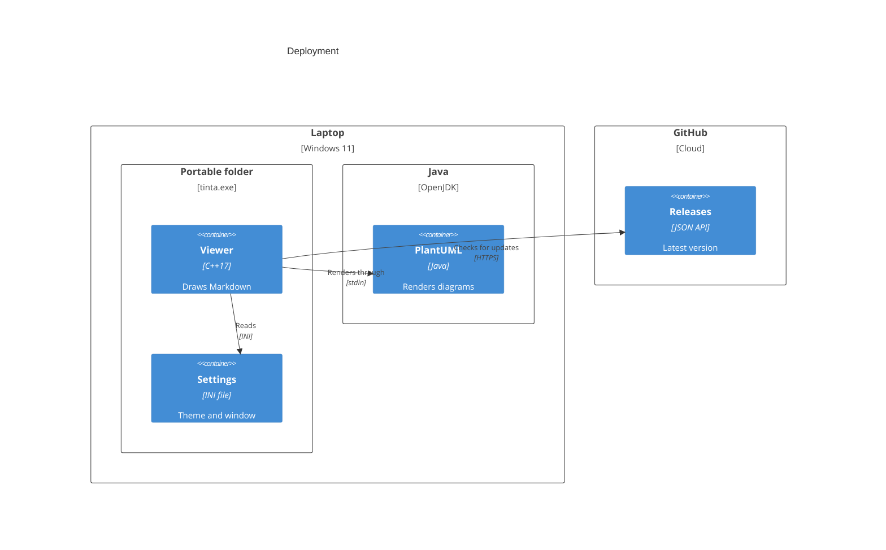
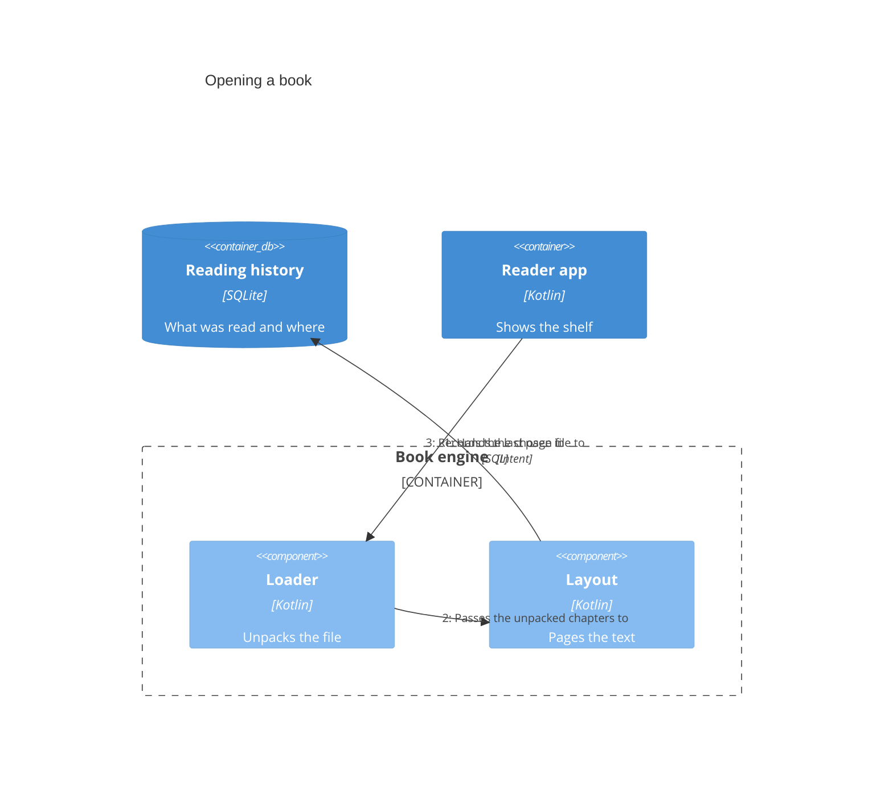

# C4 relationship labels

Every relation label in these **C4** diagrams should sit on its own line, in
the free space between the boxes: never on a person, system, container,
component, node or boundary, never on their text, and never on another
label. The diagram source follows the
[Mermaid C4 syntax](https://mermaid.js.org/syntax/c4.html), which is modelled
on [C4-PlantUML](https://github.com/plantuml-stdlib/C4-PlantUML).

| Diagram | Kind | What it exercises |
| --- | --- | --- |
| Tinta in context | `C4Context` | The reported layout: two labels between neighbours |
| Every relation keyword | `C4Container` | `Rel_U` to `Rel_Back`, crossing a row |
| Two-way relations | `C4Context` | `BiRel`, alone and beside a `Rel` |
| Boundaries | `C4Container` | Labels inside, outside and across frames |
| Three rows | `C4Component` | Relations that skip a row or a column |
| Busy neighbours | `C4Container` | Up to three relations between two boxes |
| Deployment | `C4Deployment` | Nested nodes |
| Opening a book | `C4Dynamic` | Long labels with technology |

## The reported diagram

> Before the fix, *Opens files in* and *Renders diagrams with* were drawn on
> top of the Tinta box and hid its description.



## Direction keywords

Tinta lays C4 elements out in rows of three, in the order they are declared.
The direction in a keyword names the arrow; it does not move the boxes:

1. `Rel_U` and `Rel_Up`, `Rel_D` and `Rel_Down`
2. `Rel_L` and `Rel_Left`, `Rel_R` and `Rel_Right`
3. `Rel_Back` and `Rel_Neighbor`

```mermaid
C4Container
    title Every relation keyword
    Person(reader, "Reader", "Browses and buys books")
    Container(web, "Web shop", "TypeScript", "Catalogue, basket and checkout")
    Container(api, "Shop API", "Go", "Orders, stock and payments")
    ContainerDb(db, "Orders", "PostgreSQL", "Orders and stock levels")
    ContainerQueue(mail, "Mail queue", "RabbitMQ", "Outgoing messages")
    System_Ext(pay, "Payment provider", "Takes card payments")
    Rel_R(reader, web, "Browses")
    Rel_Right(web, api, "Places orders with", "JSON/HTTPS")
    Rel_L(api, web, "Confirms orders to")
    Rel_D(api, pay, "Charges cards with", "HTTPS")
    Rel_Down(web, mail, "Queues receipts on")
    Rel_Up(mail, reader, "Emails receipts to")
    Rel_Left(mail, db, "Reads order details from")
    Rel_Back(pay, mail, "Payment events")
    Rel_Neighbor(api, db, "Stores orders in", "SQL")
    Rel_U(db, api, "Reports stock levels to")
```

## Two-way relations

A `BiRel` has an arrow at each end. Beside another relation between the same
two boxes, each keeps its own line.



## Boundaries

- A label may sit inside a boundary or outside it, never across its dashed
  frame or on its caption.
- Nested boundaries keep their own gaps.



## Three rows



## Busy neighbours

**Several relations between the same two boxes** run side by side, each with
its label on its own line:



## Deployment



## Opening a book



The text after the diagrams still lays out:

```text
mermaid fences above: 8
```
