# Mermaid front matter and ER examples (#261)

Mermaid lets a diagram open with a YAML **front matter** block between `---`
lines, for a `title` or `config`. Tinta should read past it and draw the
diagram, not show the source. The ER examples below are the ones in
[Mermaid's ER diagram documentation](https://mermaid.js.org/syntax/entityRelationshipDiagram.html),
in order; the first one is what you get by copying the page's opening example.

> Each block below should render as a diagram, in every theme.

## Front matter on other diagram types

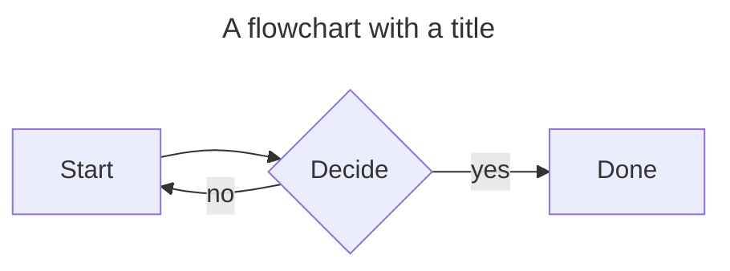

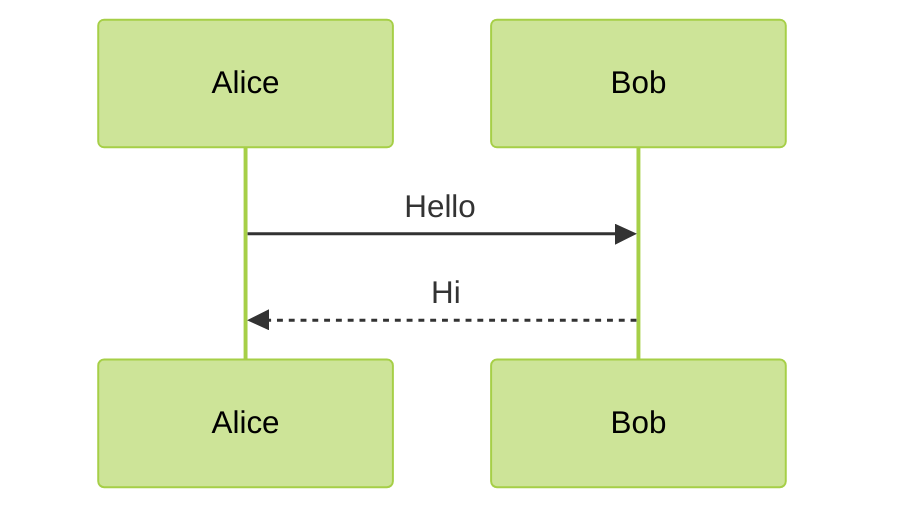

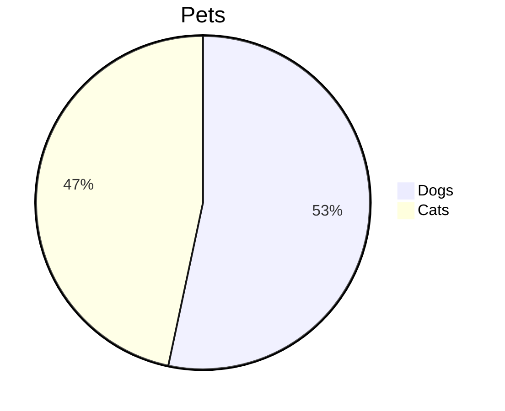

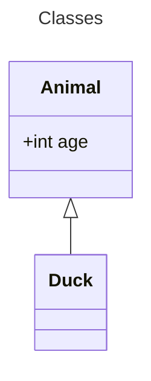

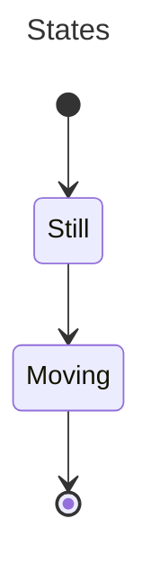

| Diagram | Front matter | Expected |
| --- | --- | --- |
| flowchart | `title` | diagram |
| sequence | `config` | diagram |
| ER (docs 1, 4, 25) | `title`, `config` | diagram |

## ER diagram documentation examples

### 1. Order example (front matter title)

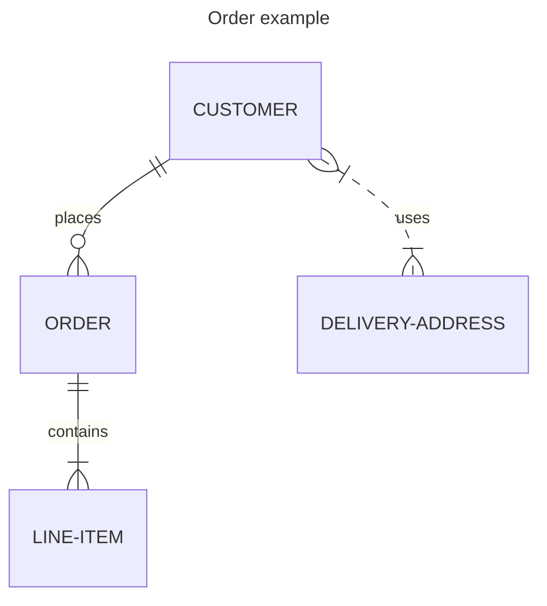

### 2. Attributes

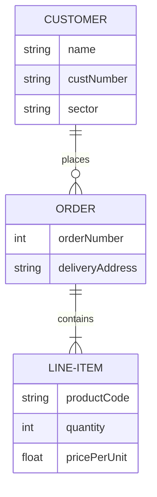

### 3. Quoted relationship label

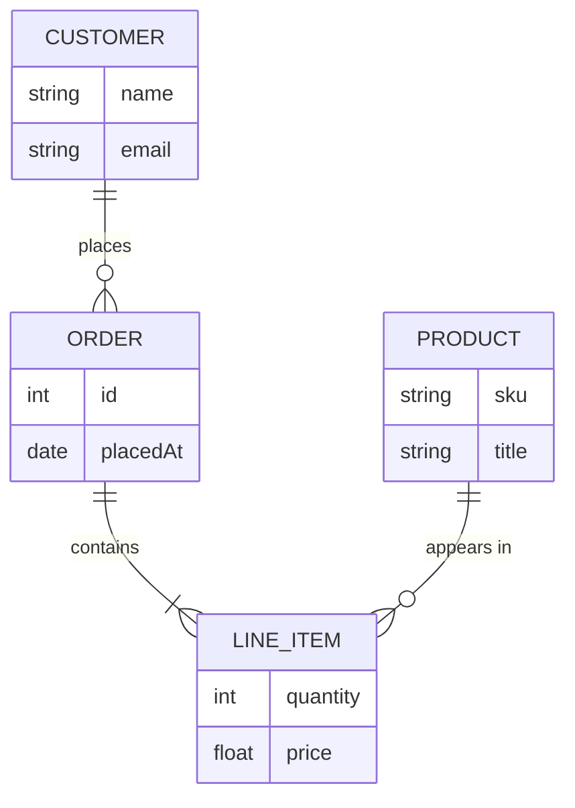

### 4. Front matter config


### 5. Unicode entity name

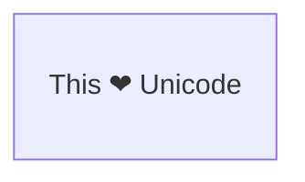

### 6. Markdown entity name

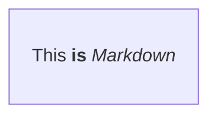

### 7. Relationships only

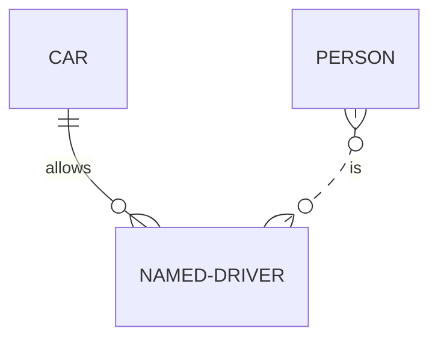

### 8. Cardinality in words


### 9. Attributes on both sides

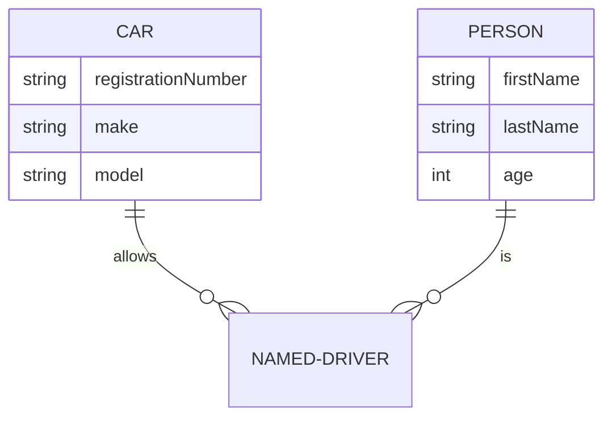

### 10. Optional attribute type

```mermaid
erDiagram
    PERSON {
        string firstName
        string? middleName
        string lastName
    }
```

### 11. Entity aliases

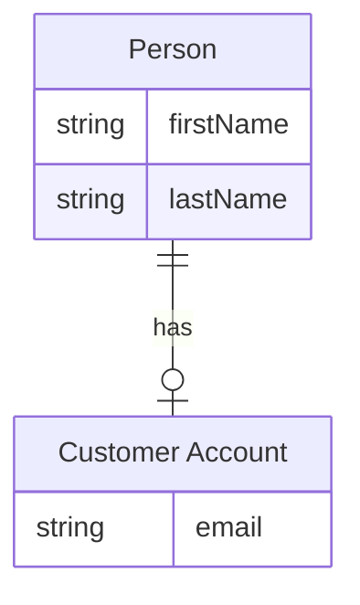

### 12. Keys and comments

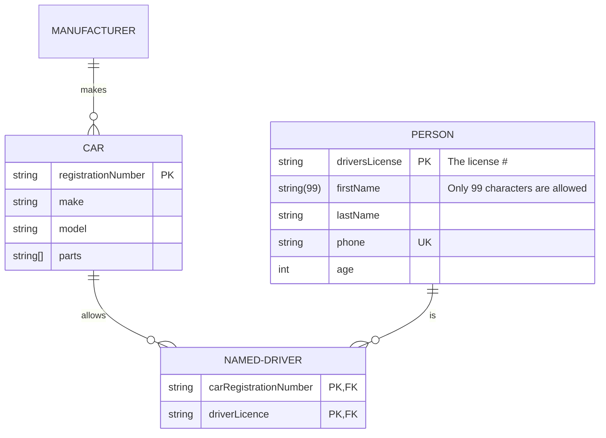

### 13. Direction TB


### 14. Direction LR

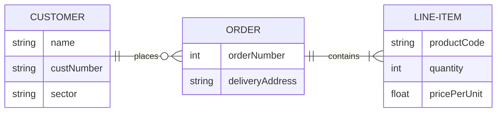

### 15. Nested subgraphs

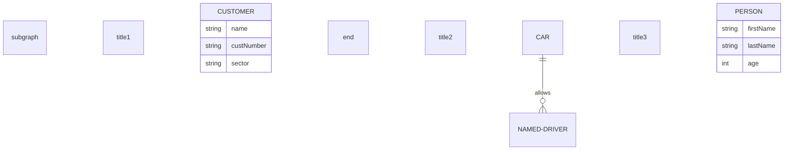

### 16. Subgraph

```mermaid
erDiagram
    subgraph title1
        CUSTOMER
    end
```

### 17. Quoted subgraph title

```mermaid
erDiagram
    subgraph "Customer Domain"
        CUSTOMER
    end
```

### 18. Subgraph id and title

```mermaid
erDiagram
    subgraph id1 [title 1]
        CUSTOMER
    end
```

### 19. Relationships between subgraphs

```mermaid
erDiagram
    subgraph title1
        A1 ||--|| A2 : links
    end

    subgraph title2
        B1 ||--|| B2 : links
    end

    subgraph title3
        C1 ||--|| C2 : links
    end

    title1 ||--|| title2 : links
    title2 ||--|| title3 : links
    title2 ||--|| C2 : links
```

### 20. Subgraph directions

```mermaid
erDiagram
    direction LR
    subgraph TOP
        direction TB
        subgraph B1
            direction RL
            I1 ||--|| F1 : links
        end
        subgraph B2
            direction BT
            I2 ||--|| F2 : links
        end
    end
    A ||--|| TOP : links
    TOP ||--|| B : links
    B1 ||--|| B2 : links
```

### 21. Styles

```mermaid
erDiagram
    id1||--||id2 : label
    style id1 fill:#f9f,stroke:#333,stroke-width:4px
    style id2 fill:#bbf,stroke:#f66,stroke-width:2px,color:#fff,stroke-dasharray: 5 5
```

### 22. Class definitions on entities

```mermaid
erDiagram
    direction TB
    CAR:::someclass {
        string registrationNumber
        string make
        string model
    }
    PERSON:::someclass {
        string firstName
        string lastName
        int age
    }
    HOUSE:::someclass

    classDef someclass fill:#f96
```

### 23. Classes on relationships

```mermaid
erDiagram
    CAR {
        string registrationNumber
        string make
        string model
    }
    PERSON {
        string firstName
        string lastName
        int age
    }
    PERSON:::foo ||--|| CAR : owns
    PERSON o{--|| HOUSE:::bar : has

    classDef foo stroke:#f00
    classDef bar stroke:#0f0
    classDef foobar stroke:#00f
```

### 24. Default class

```mermaid
erDiagram
    CAR {
        string registrationNumber
        string make
        string model
    }
    PERSON {
        string firstName
        string lastName
        int age
    }
    PERSON:::foo ||--|| CAR : owns
    PERSON o{--|| HOUSE:::bar : has

    classDef default fill:#f9f,stroke-width:4px
    classDef foo stroke:#f00
    classDef bar stroke:#0f0
    classDef foobar stroke:#00f
```

### 25. Title and config together

```mermaid
---
title: Order example
config:
    layout: dagre
---
erDiagram
    CUSTOMER ||--o{ ORDER : places
    ORDER ||--|{ LINE-ITEM : contains
    CUSTOMER }|..|{ DELIVERY-ADDRESS : uses
```

Text after the last diagram, with **bold**, a [link](https://mermaid.js.org)
and `code`, still lays out below it.
