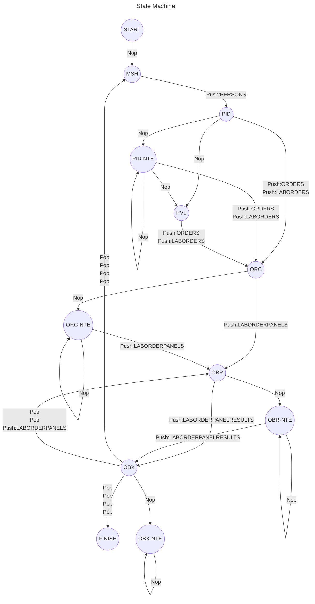
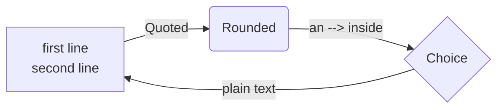

# Mermaid labels over several lines (#281)

Mermaid lets a **double-quoted** label run over lines; each line break is a
line of the label. The diagram below is the one from the report: front
matter, a `%%` comment, circle nodes with `-` in their IDs, loops, and edge
labels of up to four lines. See [Mermaid's flowchart syntax](https://mermaid.js.org/syntax/flowchart.html).

| Form | Source | Label |
| --- | --- | --- |
| Edge text | `-- "Nop" -->` | Nop, without the quotes |
| Pipe text | `-->\|"Quoted"\|` | Quoted |
| Over lines | a line break inside the quotes | one line of the label per source line |

A smaller diagram with a quoted node label over two lines and an arrow
inside quoted edge text:

> Single quotes are not Mermaid strings, so an apostrophe in a label such as
> `A[Don't stop]` still leaves the next line alone.

- Lines of a label are trimmed: the source's indentation is not part of it.
- Error lines after a label that ran over lines still count from the top.
